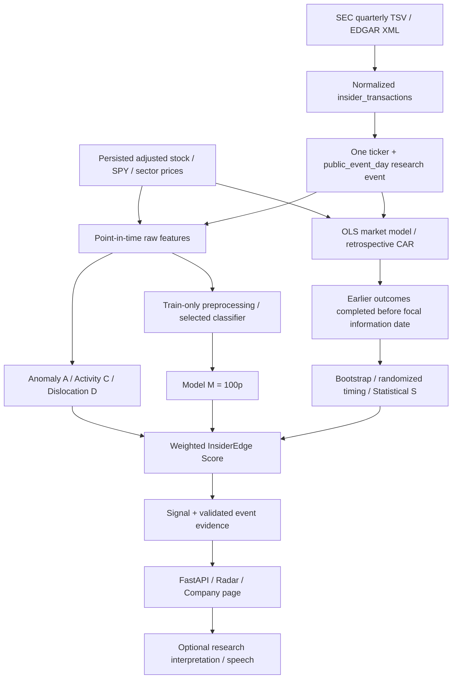
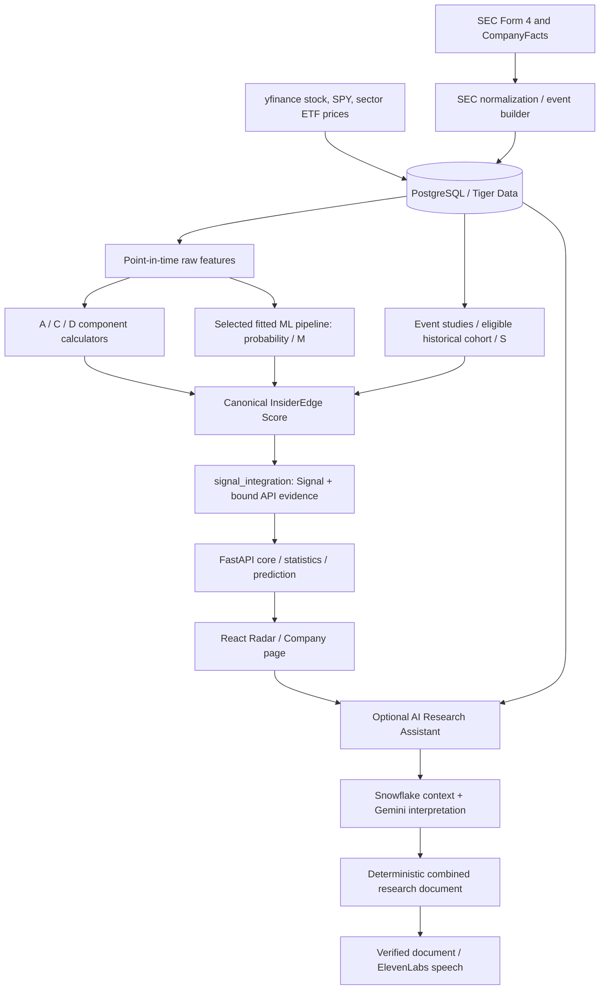

# InsiderEdge

## Overview

InsiderEdge converts public SEC insider transactions into a **quantitatively prioritized research queue** using engineered scoring, machine learning, and statistical event-study evidence. AI provides supplementary interpretation and speech.

A high score means **research priority**, not a trading recommendation, personalized advice, or evidence that insider purchases cause returns.

[Primary application](https://insideredge.work) · [Fallback](https://insider-edge-omega.vercel.app) · [API docs](https://insideredge-api.onrender.com/docs) · [Methodology](docs/MODEL_SPEC.md)

## Hackathon Problem

Form 4 feeds show what was disclosed. Researchers still need to ask: Is this combination unusual? Has activity increased? Is the stock lagging its sector? What happened after comparable earlier events, and how uncertain is that evidence? What was knowable at the time?

We bring those questions and their source evidence into one workflow. The contribution is disciplined research prioritization, not exclusive access to filings or an established profitable strategy.

## What InsiderEdge Does

1. Normalizes SEC transactions while retaining filing provenance.
2. Groups qualifying purchases into one security/session research event.
3. Engineers information-time features and historical comparisons.
4. Computes component scores and a selected classifier's probability, then combines them into research priority.
5. Persists aligned evidence and serves Radar/company research through FastAPI.
6. Displays prices, filing markers, component/statistical evidence, and optional generated research/audio.

The dependency order matters: **ML probability and historical statistical support contribute to IES**, rather than being calculated from IES.

## Quantitative Pipeline



Current-event CAR is an outcome, not a predictive input. S uses eligible **earlier** events' completed outcomes.

## InsiderEdge Scoring Model

### Notation and transformations

`I` is event `information_date`; `P` is adjusted `analysis_price`. Returns/probabilities are decimals: 0.04 means 4%. Scores use 0–100. Trading-session lookbacks differ from calendar-day activity windows. `clip(x,a,b)` bounds x to `[a,b]`.

Purchase-value logs are natural logarithms; nonpositive/missing values have no log. Ordinary z-scores use sample SD: `z=(x−mean)/s`; insufficient/constant references remain missing. Percentiles are ranks within specified references, not probabilities of future gains. There is no general winsorization step in these scoring modules.

### A — anomaly

[anomaly.py](backend/app/quant/anomaly.py), `build_anomaly_scores`, uses five dimensions: log purchase value, supported buyers over 30 calendar days, prior 30-session return, prior 30-session volatility, and prior 90-interval drawdown. All five must be usable.

References have strictly earlier information dates: same sector if **30** complete vectors exist, otherwise prior frozen-universe events, still requiring 30. For reference mean μ and sample covariance Σ:

$$
\lambda=10^{-8}\max(\max_j\Sigma_{jj},1),\qquad
 d_M^2=(x-\mu)^T(\Sigma+\lambda I_5)^{-1}(x-\mu)
$$

$$
A=\operatorname{clip}(100F_{\chi^2_5}(d_M^2),0,100)
$$

The code solves a linear system, rather than explicitly inverting covariance. Ridge regularization stabilizes correlated/singular features.

**Intuition/use:** higher A identifies unusual combinations while accounting for correlation. Unusual does not mean bullish. Chi-square calibration assumes approximate multivariate normality; A is not a calibrated outperformance probability. Missing dimensions/reference history leave it unavailable.

### C — insider activity / cluster

[activity.py](backend/app/quant/activity.py), `build_activity_scores`, uses inclusive recent `[I−29,I]` and historical `[I−394,I−30]` calendar windows. N counts distinct ticker research-event days, not every transaction line:

$$
r_{recent}=N_{30}/30,\quad r_{history}=N_{365}/365,\quad \rho=r_{recent}/r_{history}
$$

The ratio is missing if historical activity is zero. Let b be supported distinct buyers in recent qualifying transactions. Incomplete canonical identity evidence leaves b unknown. For n prior reference observations:

$$
P_{weak}(v)=100\frac{\#\{v_i\leq v\}}n,\qquad C=0.5P_{weak}(b)+0.5P_{weak}(\rho)
$$

Prefer prior company history with at least 10 earlier rows, otherwise sector history. Buyer/rate distributions separately need **10 usable observations**. Both percentiles are required; no missing-component reweighting.

**Intuition/use:** higher C means stronger participation and purchase frequency relative to history. Owner-name strings and filing-wide joint-filer groups are not buyer identity evidence.

### M — model probability

[training.py](backend/app/ml/training.py), `predict_selected`, supplies p:

$$
M=100p,\qquad p=\widehat P(R_{stock,30}>R_{SPY,30}\mid x)
$$

**Intuition/use:** a 60% estimated outperformance probability becomes M=60, not a 60% expected return. Missing predictions stay missing.

### S — statistical support

[statistical_validation.py](backend/app/quant/statistical_validation.py), `build_statistical_validations`, requires **10 eligible historical comparators**. q is the fraction of bootstrap mean CAR30 values strictly positive; p_rand is the corrected timing-test p-value:

$$
B_{support}=100\operatorname{clip}\left(\frac{q-0.5}{0.5},0,1\right)
$$

$$
P_{support}=100\operatorname{clip}\left(1-\frac{p_{rand}}{0.10},0,1\right),\qquad S=0.5B_{support}+0.5P_{support}
$$

**Intuition/use:** combine positive historical support with stronger timing evidence. These support mappings and 0.10 cutoff are heuristics, not guarantees. Both components must exist. Valid bootstrap evidence survives randomization failure, but S stays null. Genuine S=0 is not missing.

### D — market dislocation

[dislocation.py](backend/app/quant/dislocation.py), `build_dislocation_scores`, uses 90 completed trading intervals before I. Define `g=R_sector,90−R_stock,90` and `h=|drawdown_90d|`. Frozen-universe cross-sectional midranks at I give:

$$
P_{mid}(v)=100\frac{\#\{v_i<v\}+0.5\#\{v_i=v\}}n,\qquad D=0.60P_{mid}(g)+0.40P_{mid}(h)
$$

Each distribution independently requires **10 usable securities**, and can include the focal security. Missing inputs do not cause reweighting.

**Intuition/use:** higher D highlights sector lag and distance below a recent peak, not proven undervaluation. Ties receive midranks, unlike C's weak ranks.

### IES — final score

[insideredge_score.py](backend/app/quant/insideredge_score.py), `score_event`:

$$
IES=0.25A+0.15C+0.30M+0.15S+0.15D
$$

| Component | Weight | Meaning |
| --- | ---: | --- |
| A | 25% | Multivariate unusualness |
| C | 15% | Relative insider activity |
| M | 30% | Estimated outperformance probability × 100 |
| S | 15% | Historical statistical support |
| D | 15% | Sector lag and drawdown |

Complete IES lies in `[0,100]`. Hard-coded hackathon weights are **not learned portfolio weights**; scientific optimality is not established.

- All five available: `complete`.
- **Only S missing for insufficient comparator history:** divide remaining weighted sum by `0.85`, mark `partial`. Only the exact documented insufficient-history reason categories permit this.
- Missing A/C/M/D or another S failure: null IES, `insufficient_data`.
- Zero stays zero. Nonfinite/out-of-range values reject. No premature rounding.

Higher IES means stronger combined evidence for investigation; lower IES means less support under this heuristic. Neither means buy/sell, expected return, certainty, or a causal effect. A high IES need not imply high p: M is only one weighted component.

### Separate incomplete-evidence displays

[quantitative_coverage.py](backend/app/services/quantitative_coverage.py) does not rewrite canonical IES:

- **Provisional Index:** at least two supported components with observed weight ≥0.50 permit `sum(w_j × component_j)/sum(w_j)` over available components, subject to identity/status/known-chronology checks. This broader descriptive reweighting differs from S-only partial IES. No imputation or fabricated M is implemented.
- **Estimated Activity Index:** with verified transaction lineage, qualifying transaction count N and aggregate purchase value V:

$$
E=100\left[0.70\min\left(\frac{\log_{10}(1+V)}8,1\right)+0.30\frac{\min(N,5)}5\right]
$$

The value term saturates at 99,999,999, count at five transactions. E measures disclosed scale/activity, not distinct buyers or predictions. Unsupported inputs remain unavailable.

Display prefers complete IES, supported provisional index, estimated activity, then a dash. **These are not interchangeable calibrated scores.** Existing incomplete historical provenance can qualify for the explicitly authorized descriptive display, not independent historical validation. See [offline research](docs/PROVISIONAL_SCORE_OFFLINE_EVALUATION.md).

## Machine-Learning Model

Sources: [dataset.py](backend/app/ml/dataset.py), [training.py](backend/app/ml/training.py), [evaluation.py](backend/app/ml/evaluation.py).

### Target and probability

One observation is one `research_event_id`. For t=0 the first session after disclosure, use adjusted prices t=−1 through t=29:

$$
R_{stock,30}=\prod_{t=0}^{29}(1+r_{stock,t})-1=\frac{P_{stock,29}}{P_{stock,-1}}-1,\qquad Y=\mathbf1\{R_{stock,30}>R_{SPY,30}\}
$$

Positive class: stock beats SPY. Negative class: underperformance or tie. All adjacent returns and outcome boundaries must validate; incomplete outcomes remain unlabeled. This target is **not CAR30**.

The code implements scikit-learn Logistic Regression and XGBoost candidates. The historical demo report selected **Logistic Regression C=0.1**; current live model identity cannot be independently established without querying production, which this review did not do. The API serves persisted per-event model names/probabilities, not an on-request model loader.

For the implemented Logistic Regression family:

$$
p(x)=\frac1{1+e^{-(\beta_0+\beta^Tx)}}
$$

For XGBoost, the binary-logistic objective applies a sigmoid to boosted tree outputs. Default classification uses `p≥0.50`; below 0.50 predicts class 0, above/equal predicts class 1. It is not a recommendation. No post-hoc probability calibration is implemented.

**IES measures multi-component research priority; p estimates a specific binary outcome.** Both exist because interpretable context and supervised outcome estimation answer different questions. Composites do not become ML inputs.

### Exact raw feature list: 23 columns

These precede one-hot encoding and exclusion of all-missing training columns.

| Features | Definition |
| --- | --- |
| `prior_return_5d`, `prior_return_30d`, `prior_return_90d` | Adjusted-price returns over completed trading intervals before I |
| `prior_volatility_30d` | Sample SD of 30 prior simple daily returns, not annualized |
| `drawdown_90d` | Last prior price / maximum of last 91 prices − 1, spanning 90 intervals |
| `volume_zscore_30d` | Latest completed volume versus preceding 30-bar baseline; ≥2 finite reference values/positive sample SD required |
| `spy_relative_return_30d`, `sector_relative_return_30d` | Stock return minus SPY/sector return on aligned dates |
| `aggregate_purchase_value`, `log_aggregate_purchase_value` | Qualifying event value and natural log when positive |
| `max_valid_ownership_change_pct` | Maximum shares-acquired / prior-shares ratio, decimal despite suffix |
| `any_new_position_flag` | Supported zero prior holdings; new-position ownership ratio remains null |
| `has_executive`, `has_cfo`, `has_director` | Event role flags; these/new-position flag allow Boolean numeric input |
| `purchase_value_7d`, `purchase_value_30d` | Qualifying value sums over inclusive calendar-day filing windows |
| `recent_purchase_rate`, `historical_purchase_rate` | Distinct event counts/day over recent 30 / preceding 365 calendar days |
| `unique_buyers_7d`, `unique_buyers_30d` | Canonically supported buyers; incomplete identities remain missing |
| `sector`, `role_bucket` | Sector and Executive/Director/Other categorical role |

[features.py](backend/app/quant/features.py), `build_event_features`, implements the measurements. Price return over k intervals is `P_last/P_(last−k)−1`; volatility uses sample SD of 30 adjacent simple returns. Ownership uses `prior_shares=shares_owned_after−acquired_shares`; only positive prior shares permit a ratio. Role hierarchy is Executive > Director > Other while flags remain separate.

Composite scores, future/current CAR, labels, identifiers, and fundamentals are excluded from the predictor allowlist. These features encode disclosed magnitude/participation, ownership/role context, and prior market conditions; optimal feature choice is not established.

### Preprocessing, training, selection

- Numeric missingness uses **training medians**. Logistic Regression standardizes numeric features; XGBoost does not. Missing categories use a sentinel and one-hot encoding; unseen categories are ignored.
- Entirely missing numeric training columns are excluded, as are rows without usable active predictors. Train/validation require both classes.
- Logistic Regression: L2 default, `liblinear`, C in `{0.1,1,10}`, maximum 1,000 iterations.
- XGBoost: depths `{2,3}`, 100 trees, learning rate 0.05, binary-logistic objective, histogram trees, full row/column sampling, single worker.
- Seed 42. Select lowest **validation Brier**, then higher validation AUC, then Logistic Regression, then stable grid order.
- No random cross-validation, automatic calibration, class weighting, early stopping, or test-driven selection.

Preferred split: train **2020–2024**, validation **2025**, test completed-outcome **2026** observations. Explicit chronological approximately 70/15/15 splitting is also supported; sparse data does not silently switch policy. Same-date groups remain together. Purge earlier observations whose 30-session outcomes touch/extend beyond the next partition's first information date.

`train_dataset` consumes validated/purged data; `predict_selected` uses the frozen fitted pipeline; `build_signals` integrates aligned outputs. There is no committed one-command end-to-end training script: the historical operational harness is documented under ignored `data/sec_cache/`, not a supported production CLI.

### Evaluation, artifacts, and recorded results

`evaluate_frozen_model` evaluates without fitting/selecting. Metrics: ROC AUC, Brier, precision, recall, F1, prevalence, count, split dates. Undefined metrics remain null.

$$
\operatorname{Brier}=\frac1n\sum_{i=1}^n(p_i-y_i)^2
$$

Lower Brier is better; AUC measures ordering discrimination. Precision/recall/F1 use threshold 0.50. Once-only evaluation discipline belongs to orchestration, not an irreversible utility lock.

Training returns an in-memory `ModelSelection` with fitted pipelines/schema/configuration/dependency versions. No tracked fitted artifact or application-integrated durable frozen evaluation loader is established. Serving uses persisted probabilities and keeps **`/prediction.metrics=null`**, never validation metrics substituted as held-out results.

[DEMO_PLAN.md](docs/DEMO_PLAN.md) records a historical selection/evaluation, not newly verified production performance:

| Historical recorded result | Value |
| --- | ---: |
| Train / validation / test rows after exclusions | 343 / 61 / 35 |
| Selected model | Logistic Regression, C=0.1 |
| Test ROC AUC | 0.565359477124183 |
| Test Brier | 0.2628824726893451 |
| Precision / recall / F1 | 0.6 / 0.5294117647058824 / 0.5625 |
| Test positives / total; threshold | 17/35; 0.50 |

These report values are **not independently reverified frozen artifacts or current API metrics**. Small samples do not establish calibrated probabilities, robust generalization, or profitability. Artifact-backed current performance: **Not established by the current implementation.**

## Statistical Validation / Event Study

### Event timing

`transaction_date` is execution; `filing_date` disclosure. Event t=0 is the first persisted SPY trading session strictly after filing. Multiple filings mapping to one ticker/session collapse into one event; **I is their latest contributing filing date**. All aggregate evidence is disclosed by I, and predictive market features stop strictly before I. Daily data does not establish intraday tradability.

### Abnormal return and CAR

[event_study.py](backend/app/quant/event_study.py), `build_event_studies`:

$$
r_{i,t}=P_{i,t}/P_{i,t-1}-1,\qquad r_{i,t}=\alpha_i+\beta_i r_{SPY,t}+\epsilon_{i,t}
$$

Fit α/β over sessions **[−120,−21]**, 100 candidate returns, requiring **60 valid pairs** and usable SPY variation. NumPy least squares performs the fit. Expected sessions are supplied/validated; missing bars cannot be compressed into fictitious shorter horizons.

$$
AR_{i,t}=r_{i,t}-(\hat\alpha_i+\hat\beta_i r_{SPY,t}),\qquad CAR_H=\sum_{t=0}^{H-1}AR_{i,t}
$$

| Outcome | Exact window |
| --- | --- |
| CAR5 | t=0..4 |
| CAR30, primary research horizon | t=0..29 |
| CAR90 | t=0..89 |

**Meaning:** positive/negative CAR is accumulated performance above/below the fitted market-model expectation. It is an arithmetic sum, not compounded excess return or simply stock minus SPY return. Incomplete horizons stay null. A positive historical CAR does not guarantee future gains or establish causality.

### Comparison cohort

`select_comparable_events` prefers earlier **same-sector + same-broad-role** events with complete CAR30; below 10, fall back to same sector, still requiring 10. Information dates and **entire CAR30 endpoints strictly precede focal I**. The current event is excluded. Selection does not depend on comparator return sign/magnitude. Cohort size varies per event, unlike total dataset size.

### Bootstrap confidence interval

Resample n eligible comparator CAR30 values with replacement, compute means, repeat **1,000 times**, default seed **13**. Mean-distribution 2.5th/97.5th percentiles give a **95% percentile interval**; q is the fraction strictly above zero.

This estimates uncertainty in the historical mean under resampling assumptions, not a future-return interval. An interval crossing zero is weak evidence for a positive mean. Repeated/overlapping events can violate independence; no clustered bootstrap correction is implemented.

### Randomized timing null

For each comparator, draw an eligible pseudo trading date for the same ticker/calendar year, excluding actual insider-event dates. Full pseudo CAR30 must finish before focal I; apply the same market-model estimation. Each replicate averages one pseudo outcome per comparator; reuse/overlap is permitted.

For actual comparator mean T_obs and B valid null means:

$$
p_{rand}=\frac{1+\#\{T_b^*\geq T_{obs}\}}{B+1}
$$

Default **1,000 valid replicates**, seed **13**, 10,000-attempt cap. All requested valid replicates are required. Ties count in the upper tail; +1 avoids zero Monte Carlo p-values. This randomizes timing, not labels.

Small p means unusual positive historical performance under this particular null, not the probability a hypothesis is true. No causality is established. Valid bootstrap evidence survives randomization failure, but combined S is unavailable.

## Preventing Data Leakage

| Boundary | Implemented protection |
| --- | --- |
| Event availability | Execution/disclosure separate; aggregate I is latest contributing filing |
| Market | Completed stock/SPY/sector prices strictly before I |
| Features | Verified allowlisted groups: market source `< I`, other source dates `≤ I`; future dates reject |
| Buyers | Transaction-associated canonical identity, not owner-name groups |
| Comparators/pseudo-events | Entire outcomes strictly before focal I |
| Labels | Future returns used as observed targets, never predictors |
| Splits | Purge earlier outcomes touching next partition's information date |
| Learned transforms | Training-only; validation selects, test does not |
| Historical demo model | Report assigned later-selected model only to 39 post-validation-boundary events, not 419 earlier events |
| Serving | Latest event first; Signal must match ID/ticker/public day |
| Rich evidence | Event/model/provenance binding; unverified legacy detail null |
| AI | Current-event CAR excluded; fundamentals filed by I |

**Information-time evidence** can support prediction then. **Retrospective validation** uses subsequently observed outcomes and can be displayed later, but cannot enter the original event's predictive inputs. Held-out metrics are not predictors either.

Strict inference cannot authenticate upstream attestations. Raw frame training cannot prove timestamps without the validated dataset. Correct orchestration/source provenance remain necessary; descriptive provisional compatibility is not full historical verification.

## Data & Research Events

A research event is one security's qualifying public purchase activity mapped to one trading session. It is also the ML observation unit when a complete target and eligible inputs exist.

| Stage | Implemented behavior | Source |
| --- | --- | --- |
| SEC retrieval | Official SEC quarterly ownership TSV archives and individual EDGAR ownership XML; configurable descriptive User-Agent, throttling and bounded retries | `backend/app/services/sec/{client,bulk,edgar}.py`, `backend/scripts/ingest_sec.py` |
| Normalization | Preserve transaction date separately from filing date, Table I/non-derivative status, code, acquired/disposed flag and source provenance; Decimal shares × price gives transaction value | `sec/normalize.py` |
| Identity/storage | Canonical transaction identities support idempotent persistence; identical source lines retain occurrence identity rather than being collapsed indiscriminately | `sec/normalize.py`, `sec/repository.py` |
| Qualification | Original Form 4, non-derivative Table I, code P, acquired A; derivatives/sales are not qualifying purchases. Amendments remain raw provenance but are excluded pending reconciliation | `events/build.py` |
| Calendar/aggregation | First persisted SPY session strictly after filing date; group ticker + public_event_day. Information date is the latest contributing filing date | `events/build.py:build_dataset` |
| Buyer identity | Count distinct transaction-supported underlying buyers; filing-wide/joint/pipe-delimited names alone do not establish that association. Unknown count is NULL with diagnostics | `events/buyers.py`, `events/build.py` |
| Roles/values | Preserve source ownership evidence and executive/director/other role context; aggregate supported purchase values. Incomplete value evidence is diagnosed, not an assertion of a complete total | `events/build.py`, `quant/features.py` |
| Rebuild safety | Retain stale events; block a proposed event if a canonical source transaction belongs to a different retained event. Reconciliation is explicit, not automatic deletion | `events/repository.py` |

`research_event_id` is `ticker:public_event_day`; the database also enforces uniqueness of that pair. A filing can contain multiple transactions; several filings can map to one event. Transaction date describes the trade, filing date public disclosure, information date the aggregate information boundary, and public event day the next session. Filing-time precision is limited by the daily-data policy.

Companies use ticker as primary key, with non-unique indexed issuer CIK. The configured universe contains 101 securities; GOOG and GOOGL remain distinct share classes. CIK-only mapping must report ambiguity when multiple tickers match; it cannot choose one arbitrarily (`services/universe.py`).

Market prices come from yfinance with automatic/back adjustment disabled; adjusted close supplies analysis prices when available. SPY supplies the market benchmark/session calendar; configured sector ETFs supply sector comparisons. BRK.B is translated to the provider's symbol format. Prices are persisted by ticker/date; missing sessions are not invented. SEC CompanyFacts supplies USD fundamentals selected only when filed by the event information date. Revenue/operating-income facts retain actual duration; conservative debt construction requires compatible current/noncurrent components, and current ratio requires compatible assets/liabilities with positive denominator. Fundamentals are contextual P1 evidence, not features in the current 23-column ML model.

The ingestion tools support bounded samples and historical ranges; that is not a guarantee of complete coverage. The dated demo report records SEC archives from 2020 through 2026 Q3 and earlier market-price baselines. Consult [SEC ingestion](backend/SEC_INGESTION.md), [market ingestion](backend/MARKET_INGESTION.md), [event dataset](backend/EVENT_DATASET.md) and [fundamentals](backend/FUNDAMENTALS.md) for operational limits.

## Evidence / Provenance

An available number is not automatically a reproducible historical result.

| Evidence layer | What exists now | What it does not establish |
| --- | --- | --- |
| PostgreSQL serving data | Raw normalized transactions, research events/feature metadata, prices, fundamentals and current Signal projections | An immutable archive of every scoring run |
| Signal integration | `build_signals` creates detailed in-memory `SignalBatch.audit`; `persist_signals` atomically upserts Signal and namespaced `signal_api_evidence_v1`, preserving unrelated metadata | Every original fitted model/input/reference population remains recoverable |
| API evidence | Exact event/model/value binding, information boundary, comparator provenance and observation cutoff; legacy unverified rich fields remain unavailable | Old rows can be enriched honestly without an explicit validated rebuild |
| Offline capture utilities | `quant/evidence/capture.py:prepare_capture` combines caller-pinned inputs and original audit outputs into typed manifests/bundles; deterministic serialization and SHA-256 support byte integrity | Automatic production capture/publication, training, filesystem writes or historical authenticity |
| Read-only verifier | `quant/evidence/verify.py:verify_bundle` checks references, supported manifest structure, byte counts and hashes; reports valid/invalid/unverifiable without loading model executables | That bytes existed at the claimed historical time or were eligible prediction inputs |
| Tests | Synthetic bundle/schema/capture/integrity fixtures exercise failure modes | Measured production model results |
| Retained narrative reports/designs | Dated demo/evaluation/provenance investigations and a proposed immutable retention architecture | Recovered original artifacts or a deployed append-only archive |

The verifier requires safe filesystem primitives and can report unverifiable when the platform cannot provide them. A matching SHA-256 proves agreement with declared bytes, not source trust or publication time. Old mutable database rows, later API exports and reconstructed files must not be presented as original historical evidence.

The [retention design](docs/SCORING_EVIDENCE_RETENTION_DESIGN.md) is explicitly a proposal. Its pinned historical inventory/no-go statements describe that baseline, not a fresh production census or the later descriptive coverage feature. The [historical recovery report](docs/HISTORICAL_SCORING_PROVENANCE_RECOVERY.md) documents missing original artifacts; [capture contract](docs/SCORING_EVIDENCE_CAPTURE_CONTRACT.md) defines the implemented offline boundary. Production-wide immutable capture and independently authenticated model availability remain incomplete.

## System Architecture

| Layer | Current stack |
| --- | --- |
| Frontend | React, TypeScript, Vite, React Router; Recharts; CSS and react-joyride |
| Backend/storage | FastAPI, Pydantic, SQLAlchemy; PostgreSQL/Tiger Data using psycopg |
| Data/statistics | SEC EDGAR/CompanyFacts, yfinance; pandas, NumPy, SciPy |
| ML | scikit-learn logistic regression/preprocessing; XGBoost candidate |
| Hosting | Vercel frontend, Render backend; [deployment guide](DEPLOYMENT.md) |
| Optional interpretation | Snowflake Cortex REST, Gemini REST, ElevenLabs TTS |



These are implemented modules, not a claim of a continuously scheduled training/backfill service. No tracked fitted-model artifact or general production artifact loader was established in this review.

Radar defaults to canonical persisted IES ordering, missing last. Search/sort and status grouping support research exploration. Explicit Research Priority sorting separates Complete, Provisional and Estimated Activity classes; it does not put their differently defined numbers on one common scale.

Company pages load core resources independently with loading/error boundaries. Unavailable metric cards/panels are hidden; genuine finite zeros remain visible. Score values come from the backend. The PriceChart plots analysis price, offers inspection/zoom, and deduplicates qualifying purchase **filing-date** markers; those markers are not event-study t=0. Recent chart changes polish labels/legend placement, not calculations. Tours run once after data load and can be reopened; they do not generate AI requests.

## AI Research Assistant

AI is a supplementary interpretation/presentation layer, not the quantitative engine.

1. **Generate AI Research** starts independent Snowflake and Gemini requests concurrently.
2. **Snowflake Cortex** supplies qualitative event/filing research context, without receiving Signal scores, ML probability, CAR or price evidence.
3. **Gemini** interprets existing quantitative backend evidence, with current-event future CAR excluded and fundamentals bounded by information date.
4. Successful sections are combined deterministically into one attributed **Research Summary**; one provider failing does not discard the other's result.
5. **Listen to Research** sends that document for verification, then ElevenLabs speaks its deterministic transcript. ElevenLabs performs no analysis.

Snowflake validates three bounded string-array sections; only overflow in known lists is sliced to the first six before unchanged strict validation. Numeric/date grounding, Decimal-equivalent values, grounded calendar/date abstractions and language checks remain separate safeguards. Gemini requests a provider-safe JSON schema and then applies strict application validation to five bounded string-array sections. Neither validation system is a proof that all generated prose is correct; inspect the underlying evidence.

Research-audio verification checks recent server-recorded generated content against current evidence and reconstructs the document; arbitrary client prose is not accepted. Verification records are bounded, short-lived and process-local, so stale content/restarts or multi-worker routing can require regeneration. Usable transcript plus failed synthesis returns HTTP 200 with `audio_unavailable` and null audio; fixed server-side categories diagnose failure without exposing provider bodies/secrets.

Providers use bounded transport and no automatic paid-request retry. Frontend deadlines are Gemini 60 seconds, Snowflake 65 seconds and research audio 75 seconds. ElevenLabs backend timeout is configurable within 1–60 seconds (default 30); code support does not establish the deployed setting. Deliberate unmount/company/event/reset cancellation remains. Failures do not alter Signals, scores, probabilities or the core page. See [AI services](backend/AI_SERVICES.md).

## Example Research Flow

The [dated demo plan](docs/DEMO_PLAN.md) records **AXP:2026-03-16**, information date **2026-03-13**, as a supported example: seven qualifying purchase transactions from one filing, one supported buyer, executive context and 17 historical comparators. It records approximately 40.01% model probability, a genuine statistical score of zero, a confidence interval crossing zero and weak randomization evidence.

This is useful precisely because it does not promise a favorable outcome: completeness of research evidence is different from strength of statistical support. The demo selection used completeness and an alphabetical tie-break, not the best realized return. Treat those figures as recorded report results, not a fresh API query or independently recovered frozen artifact. Confirm the event shown in the UI before presenting; do not borrow an older Signal for a newer event.

## Important API Endpoints

| Method/path | Purpose |
| --- | --- |
| `GET /health` | Process health; not a comprehensive database/provider readiness check |
| `GET /api/radar` | Latest-event research queue and availability/coverage context |
| `GET /api/companies/{ticker}` | Exact security metadata and latest matching Signal |
| `GET /api/companies/{ticker}/prices` | Persisted price history |
| `GET /api/companies/{ticker}/insiders` | Normalized insider evidence |
| `GET /api/companies/{ticker}/statistics` | Anomaly/activity/event study/statistical validation/market sections |
| `GET /api/companies/{ticker}/prediction` | Model name, probability, threshold, nullable metrics and status |
| `POST /api/companies/{ticker}/snowflake-research` | Optional qualitative context |
| `POST /api/companies/{ticker}/explain` | Optional five-section Gemini explanation |
| `POST /api/companies/{ticker}/brief` | Existing deterministic analyst brief/audio path |
| `POST /api/companies/{ticker}/research-audio` | Verified combined Research Summary speech |

Statistics and prediction select the latest event first and require exact Signal association; they never substitute an older scored event. Unknown tickers return 404; known tickers without an event also return 404 for these event-specific reads. Missing evidence remains null with honest statuses. Prediction's held-out metrics remain null without a durable frozen evaluation artifact; validation metrics are not substituted. See [API contract](docs/API_CONTRACT.md), actual routers and `/docs` for schemas/parameters, including additive features beyond the original core contract.

## Running Locally

Use Python with the repository requirements and Node/npm with the frontend lockfile. PostgreSQL/Tiger Data is required for real persisted reads; frontend development mocks do not establish database/provider connectivity. No current tracked Docker/Compose setup was found; older architecture sketches are not runnable Docker instructions.

From the repository root in PowerShell:

```powershell
python -m venv .venv
.\.venv\Scripts\python -m pip install -r backend/requirements-dev.txt
Copy-Item .env.example .env
cd backend
..\.venv\Scripts\python -m uvicorn app.main:app --reload --env-file ..\.env
```

Copy the template only when creating a new local file; do not overwrite an existing configuration. Configure it privately, keep it ignored, and never print/stage credentials. The application itself reads process environment; Uvicorn's explicit `--env-file` above loads root `.env`. Ingestion scripts have their own root dotenv loading. Initialization needs the database variable in its process environment:

```powershell
# From backend/, after configuring the process environment privately:
..\.venv\Scripts\python -m scripts.init_db
```

Initialization creates missing tables, not data or migrations. Review existing migration instructions before reusing an older database. Do not ingest a full backfill merely to check setup.

In a second terminal:

```powershell
cd frontend
npm ci
npm run dev
```

Use an ignored `frontend/.env.local` for local Vite settings. Variable **names** and roles:

| Variable | Purpose |
| --- | --- |
| `DATABASE_URL` | Private PostgreSQL connection configuration |
| `SEC_USER_AGENT` | SEC-compliant descriptive contact identity |
| `CORS_ORIGINS` | Explicit allowed frontend origins; include local browser origin when using a real backend |
| `VITE_API_BASE_URL` | Public API origin; defaults to local backend on port 8000. Production build requires a valid HTTPS non-local origin |
| `VITE_USE_MOCKS` | Development core-data mock switch; disable for real reads |
| `VITE_EXPLAIN_MOCK` | Development Gemini mock switch; disable for real explanation generation |
| `GEMINI_API_KEY`, `GEMINI_MODEL`, `GEMINI_TIMEOUT_SECONDS` | Optional Gemini credentials/model/deadline |
| `SNOWFLAKE_ACCOUNT_URL`, `SNOWFLAKE_PAT`, `SNOWFLAKE_MODEL`, `SNOWFLAKE_TIMEOUT_SECONDS` | Optional Cortex account/auth/model/deadline |
| `ELEVENLABS_API_KEY`, `ELEVENLABS_VOICE_ID`, `ELEVENLABS_MODEL`, `ELEVENLABS_TIMEOUT_SECONDS` | Optional speech credentials/voice/model/deadline |

Both development mock flags default to enabled unless explicitly disabled; changing only the API base is insufficient. Restart Vite after changing environment configuration. Frontend variables are public build inputs: never put provider credentials in a `VITE_` variable. The browser calls InsiderEdge endpoints; provider credentials stay server-side. Real generation can incur charges and is not needed for ordinary automated tests.

The branded production frontend is linked above; Vercel remains fallback hosting and Render hosts the API. Local frontend configuration does not change production. See [DEPLOYMENT.md](DEPLOYMENT.md) for domain/CORS/deployment details rather than assuming a local configuration is deployed.

## Testing

```powershell
# From backend/
..\.venv\Scripts\python -m pytest -q

# From frontend/
npm test
npm run build
npm run lint

# From repository root
git diff --check
```

Configure the public API origin before the production frontend build; build includes `tsc --noEmit`. The frontend test command runs the component `.test.tsx` suite through tsx/Node; tests mock transport rather than call paid providers.

| Coverage | Representative tests |
| --- | --- |
| Features/components | `test_features.py`, `test_anomaly.py`, `test_activity.py`, `test_dislocation.py`, `test_insideredge_score.py` |
| Statistics | `test_event_study.py`, `test_statistical_validation.py`: windows, missing sessions, comparators, deterministic resampling |
| ML | `test_ml_dataset.py`, `test_ml_training.py`, `test_ml_evaluation.py`: targets, purging, training-only transforms, selection/evaluation |
| Evidence | `test_evidence_schemas.py`, `test_evidence_capture.py`, `test_evidence_integrity.py`: canonical bytes, identity/reference checks, filesystem boundaries |
| Ingestion/API | Foundation, SEC, aggregation, CompanyFacts, core API and signal-integration suites |
| Optional AI | `test_ai_services.py`, `test_snowflake_research.py` and research-document/audio tests: malformed output, grounding, independent fallback, safe diagnostics |
| Frontend | `AIResearchAssistant.test.tsx`, `PriceChart.test.tsx`, `MetricVisibility.test.tsx` and other component tests: orchestration, cancellation, chart interaction and zero/missing visibility |

Test fixtures are synthetic unless explicitly documented otherwise. Evidence-integrity tests rely on filesystem/platform capabilities; Windows behavior can differ from POSIX. Report actual environment-specific failures rather than claiming universal green results. This README review did not execute suites or live integrations; historical test counts are not current validation results.

## Limitations

- SEC public disclosure is delayed relative to the trade; daily dates cannot establish intraday availability. Joint-filer identity and amendments require conservative treatment.
- A frozen security universe and incomplete historical inputs limit coverage and generalization. Shared CIKs do not resolve share-class ownership automatically.
- Small reference/cohort sizes produce missing outputs; missingness is not zero. Descriptive fallback indices are not calibrated substitutes for complete IES.
- Anomaly normality assumptions, fixed score weights, pseudo-event design and overlapping historical outcomes constrain interpretation; no causal identification or proven trading profitability is established.
- The reported held-out sample is small. Model probability is a selected classifier output, not demonstrated calibration or guaranteed future outperformance.
- Fundamentals preserve filed dates/durations but are not a complete standardized quarterly/TTM accounting model and do not enter the current ML feature list.
- Current serving projections are mutable. Missing original model/run artifacts prevent a blanket claim that every historical score can be independently reproduced.
- Generated prose can be wrong despite validation. Provider availability, bounded timeouts, free-hosting latency and process-local document verification affect optional AI/audio.
- This repository inspection establishes code behavior, not current production data, deployed configuration or live availability.

## Hackathon Presentation Guide

Aim for **5 minutes 40 seconds**; approximately half the time explains quantitative reasoning. The central story is messy public disclosures → clean events → information-time features → engineered priority plus independent classifier → uncertainty-aware research, with AI last.

| Time | Say | Show | Technical takeaway / avoid |
| --- | --- | --- | --- |
| 0:00–0:40 | “A purchase disclosure is a starting point. Researchers need unusualness, context and uncertainty.” | One raw filing versus Radar | Public data needs disciplined interpretation; avoid stock tips |
| 0:40–1:10 | “We normalize transactions into one ticker/session event and rank research priority.” | Pipeline/event diagram | Preserve raw transactions; avoid ingestion flag details |
| 1:10–2:00 | “A measures multivariate unusualness, C activity, D sector lag; fixed weights combine them with model and historical evidence.” | IES formula and component bars | Normalized components have different meanings; weights are engineered, not optimized |
| 2:00–2:40 | “The classifier predicts 30-session SPY outperformance from raw features, without composite scores or future returns.” | Target/features/time-split diagram | Probability differs from priority; avoid calling it calibrated accuracy |
| 2:40–3:30 | “OLS removes fitted market exposure; bootstrap and randomized timing assess earlier comparable events. All outcomes must finish before the focal boundary.” | CAR, CI, p-value and timeline | Uncertainty and temporal discipline; avoid causal/statistical-significance promises |
| 3:30–4:30 | “Here is one research event, its source purchases, probability and historical evidence.” | AXP Company page, score/statistics/chart | A genuine zero or weak result is informative; avoid interpreting hidden data as zero |
| 4:30–5:10 | “FastAPI serves persisted evidence. Optional providers explain it and speak a verified document.” | Architecture + combined Research Summary | AI does not calculate scores; avoid waiting through a full provider/audio call |
| 5:10–5:40 | “This is research prioritization, with small-sample and provenance limits. Our next step is durable model/run evidence and broader temporal validation.” | Limitations/evidence slide | Clear boundaries build credibility; avoid unsupported performance headlines |

## Math & Model Talking Points for Judges

Each row supplies the technical explanation, a ten-second version, rationale, and a concise defense. Formulas and exact definitions appear above.

| Concept / technical explanation | 10-second explanation | Why used | Likely question → concise answer |
| --- | --- | --- | --- |
| **Anomaly:** regularized Mahalanobis distance on five inputs, chi-square CDF scaling | “How unusual is this combination relative to prior events?” | Accounts for correlated feature scales | “Is A a probability of profit?” → No; it is an approximate multivariate unusualness percentile |
| **Activity:** buyer-count and recent/historical rate ECDF percentiles, equally weighted | “Are more supported buyers active, and has the pace increased?” | Separates level from change | “Why not count all filing owners?” → Only transaction-supported identities count; ambiguity stays unknown |
| **Dislocation:** 60% sector-lag percentile, 40% drawdown-magnitude percentile | “Is the stock lagging its sector and below its recent peak?” | Adds market context | “Does lag guarantee rebound?” → No; it is research context |
| **Normalization:** log purchase magnitude; distinct weak-ECDF and midrank transforms; z-score volume | “Put differently scaled evidence on interpretable scales.” | Prevents raw units dominating comparisons | “Are all percentiles identical?” → No; activity and dislocation use different documented tie conventions |
| **IES:** fixed weighted A/C/M/S/D, with narrowly defined missing-S renormalization | “A transparent research-priority composite, not a return forecast.” | Combines complementary evidence | “Were weights optimized?” → Not established; they are hard-coded design choices |
| **Classifier:** train-only preprocessing; logistic/XGBoost candidates; validation Brier selection | “Estimate the chance of beating SPY over 30 sessions.” | Adds a learned conditional estimate from raw inputs | “Why logistic regression?” → It is a supported candidate and the reported historical winner; current deployed artifact identity is not independently established |
| **Probability:** positive-class output; M scales it by 100; threshold 0.5 | “Probability and research priority answer different questions.” | Keeps model output interpretable apart from the composite | “Does 0.6 mean calibrated 60% success?” → Calibration has not been established |
| **AR/CAR:** OLS market-model residuals summed over a complete horizon | “Performance beyond fitted market exposure, accumulated after disclosure.” | Distinguishes broad market movement from residual performance | “Is CAR simply stock minus SPY?” → No; alpha and beta are fitted on pre-event observations |
| **Bootstrap:** resample eligible historical CAR30 values; percentile CI of means | “How uncertain is the historical average?” | Shows finite-sample variability | “Does a 95% interval guarantee this event?” → No; it concerns the historical mean under resampling assumptions |
| **Randomized timing:** upper-tail comparison against same-ticker/year pseudo-event means | “Was historical performance unusual versus alternative dates?” | Tests timing against a concrete null | “Is p the chance the thesis is false?” → No; it is a null-tail statistic for this procedure |
| **Point-in-time design:** features precede information boundary; complete outcomes precede comparator use; purged splits | “Do not let tomorrow's prices explain yesterday's decision.” | Prevents obvious look-ahead paths | “Are future prices used anywhere?” → For observed labels/retrospective CAR, never as the focal predictive inputs |
| **Provenance:** event/model binding plus offline typed manifests/hash verification | “A result needs its inputs, model and availability evidence.” | Supports auditability and exposes gaps | “Can every old score be reproduced?” → No; original historical artifacts are not universally retained |

## Likely Judge Questions

| Question | Implementation-backed answer |
| --- | --- |
| What exactly is predicted? | Whether the stock's compounded 30-session return exceeds SPY's; ties are negative class |
| What does IES mean/how is it calculated? | Research priority: 0.25A + 0.15C + 0.30M + 0.15S + 0.15D. A unusualness, C activity, M scaled probability, S historical statistical support, D dislocation |
| Why score and probability? | The classifier estimates one target; IES includes other contextual evidence. The two are related through M but not identical |
| Why these features? | They represent pre-disclosure market context and purchase/owner activity. The code defines 23 columns; causal relevance or optimality is not established |
| How were weights chosen? | Hard-coded project choices; scientific optimization of them is not established by the current implementation |
| Above/below 0.5? | The classification threshold, not a trading rule or a calibrated promise |
| How did you test meaningful signal? | Chronological held-out classification metrics plus historical CAR bootstrap/randomized-timing evidence; neither establishes causation |
| AR versus CAR? | AR is a daily OLS market-model residual; CAR sums those residuals over 5, 30 or 90 sessions |
| What does p mean? | The fraction of randomized null means at least as large as the observed mean, with the implemented add-one correction |
| What does the CI mean? | A percentile bootstrap interval for the eligible historical mean, not this event's future price range |
| What cohort/sample size? | Prior same-sector/role events with completed CAR30; sector fallback, minimum ten. AXP's report has 17 comparators; model test report has 35 rows. These are different samples |
| How avoid leakage/future prices in today's score? | Strict pre-information market windows, eligible prior outcomes, train-only transforms and purged temporal partitions. Current-event future CAR is not a score/ML feature |
| Missing fundamentals? | Preserve nulls/diagnostics; current classifier does not consume them |
| Can old scores be audited? | Event-bound serving evidence helps; offline capture/verifier tools exist. Complete original model/run retention for every historical row is not established |
| What is persisted? | Transactions, events/metadata, prices, fundamentals, current Signal/version and bound API evidence; not an automatic immutable archive of fitted models/runs |
| What does Snowflake add? | Qualitative filing/event research context, independent of numerical score generation |
| Does Gemini change IES? | No; it interprets supplied backend evidence |
| Is ElevenLabs analyzing? | No; it speaks the verified deterministic combined research transcript |
| Provider failure? | Keep the successful provider's research; audio failure preserves transcript; core quantitative pages remain usable |
| Largest limitation? | Limited eligible samples and incomplete original historical provenance constrain claims of generalization/reproducibility |
| Next with more time? | Proposed follow-up: durable authenticated run/model retention and broader chronological validation before stronger predictive claims; these are not current production guarantees |

## Science-Fair Demo Strategy

1. Open Radar and explain canonical research priority plus clearly labeled incomplete-data classes.
2. Open **AXP** if the recorded event/evidence is still present; confirm the event ID first.
3. Show supported purchases and the score/components. Explain that higher means “investigate,” not “buy.”
4. Point to model probability and its separate 30-session SPY-outperformance target.
5. Show CAR/cohort, bootstrap interval and randomization p-value. Explain the genuine S=0 in the recorded example rather than hiding weak evidence.
6. Briefly inspect PriceChart and a filing marker; distinguish disclosure date from next-session t=0.
7. Generate AI Research once if desired, or show previously generated current-session output. Keep the quantitative explanation going while requests finish.
8. Show the combined, attributed Snowflake/Gemini summary. Optionally play only a few seconds of already available audio.
9. Finish with leakage controls and limitations. If providers/hosting are unavailable, use a clearly dated report or labeled screenshot, never an invented live result.

Keep an event/timeline diagram, the five-term score formula and one uncertainty example visible on the poster. The strongest three ideas are **multivariate unusualness**, **time-separated probability versus priority**, and **uncertainty-aware historical event studies**. Provider names belong in the supporting architecture story, not the headline contribution.
